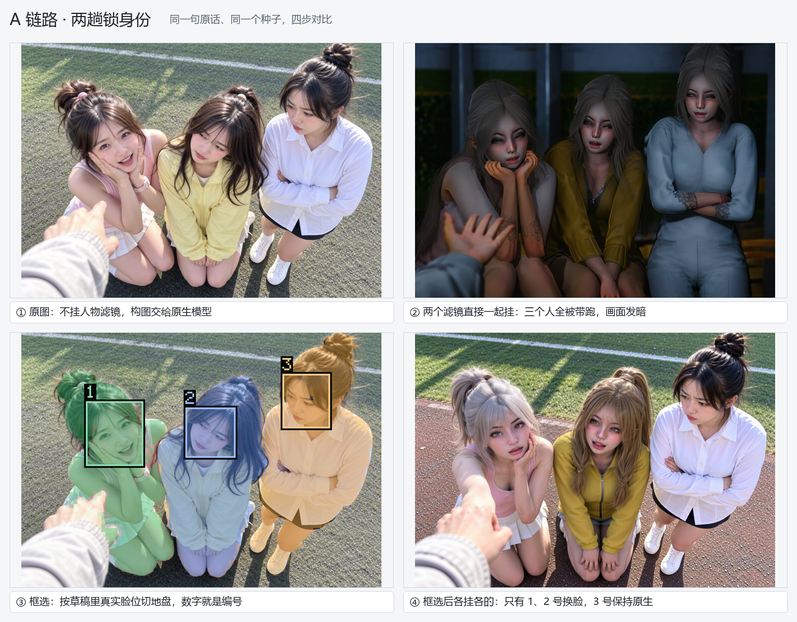
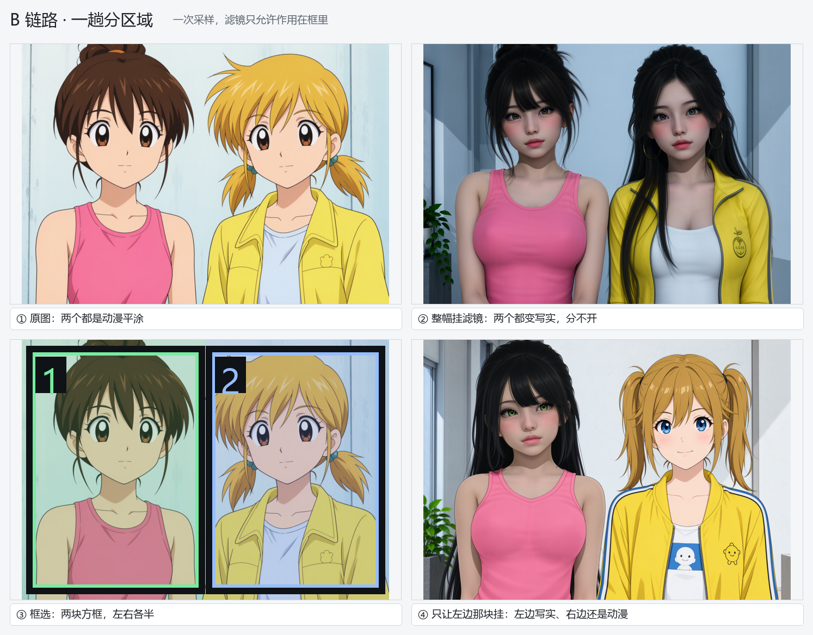
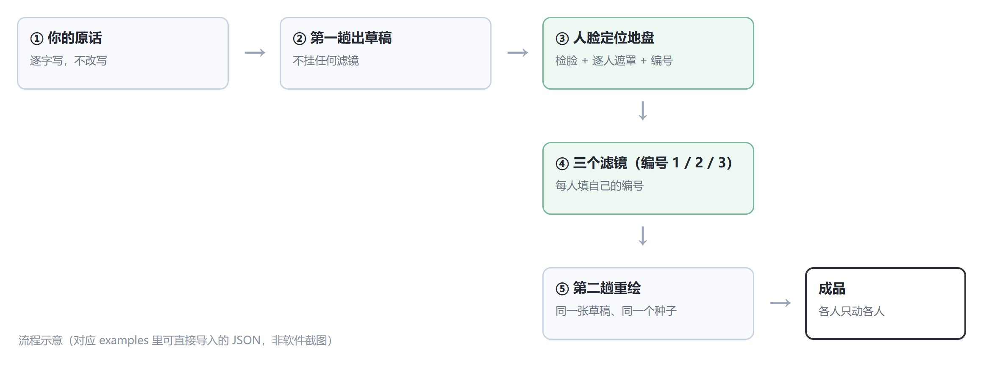
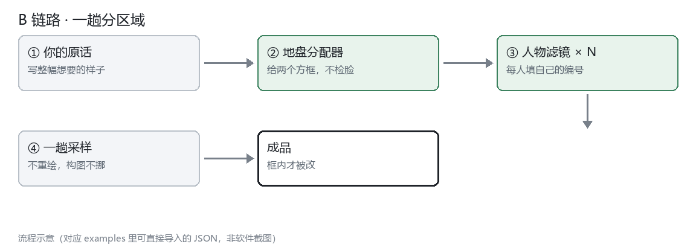
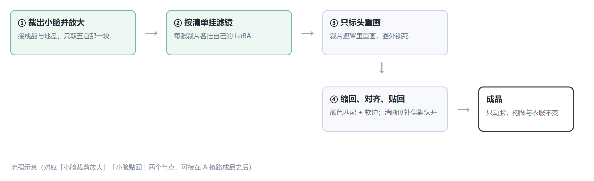

# MOSS 多身份分区 · ComfyUI-MOSS-MultiID

给 MOSS-Image 这类模型做**区域化的 LoRA**：挂上去的滤镜不再"全局一起改"，而是只在你指定的那块画面里起作用。

> [!NOTE]
> 只往 `ComfyUI/custom_nodes/` 里加这一个文件夹，**不改 ComfyUI 本体、不改任何模型权重文件**。删掉这个文件夹即可完全还原。节点界面全中文，每个输入框都有说明。

---

## 先看效果

### A 链路 · 两趟锁身份

同一句原话、同一个种子，四个阶段：



- 第 ② 格是很多人踩的坑：两个滤镜一起挂，三个人**全被带跑**，画面整体发暗。
- 第 ③ 格是节点自己算出来的归属：每个人一块颜色，交界按比例过渡，**大号数字就是滤镜节点里要填的编号**。
- 第 ④ 格只有 1、2 号换了脸，**3 号没接滤镜，保持原生**。

### B 链路 · 一趟分区域

一次采样，不重绘，滤镜只允许作用在框里：



第 ④ 格是关键：**左边那位被推向写实质感，右边那位还是原来的动漫平涂**，两人交界处没有难看接缝。

---

## 为什么需要它

MOSS-Image 是**单流 DiT**：图像和文字被拼成同一条序列一起做注意力。这带来两个后果——

1. **LoRA 是全局生效的。** 挂两个滤镜，两个人就互相污染：A 长出 B 的五官，或者两张脸都变成"平均脸"。
2. **常规的区域控制手段在这里静默失效。** `ConditioningSetMask`、`ConditioningSetArea`、Regional Prompter 这类节点依赖模型去读注意力遮罩，而这类模型不读——**它们不报错，但也完全不起作用**，很容易让人以为是自己的问题。

本插件的做法：不把滤镜并进模型权重，而是在注意力计算时**逐格补一笔**，补多少由"这一格归谁"决定。所以：

- 归属表随时可改，不用重新合并权重、不用反复加载模型
- 一格可以按比例分摊（两个人交界那一圈各拿一半）
- 不属于任何人的格子（比如第一人称视角伸进画面的手）**一格滤镜都不拿**

---

## 两套用法

|  | **A 两趟 · 锁身份** | **B 一趟 · 分区域** |
|---|---|---|
| 适合 | 必须是"就是这个人"；多人交错、姿态复杂 | 想让滤镜只管某一块；一次出图、不想重绘 |
| 区域怎么来 | 先出一张草稿，按草稿里**真实人脸位置**＋逐人身体遮罩自动切 | 你自己给方框（手填，或从画框工具连过来） |
| 采样次数 | 两次（第一趟定构图，第二趟同种子重绘） | 一次 |
| 构图 | 第一趟就是原生构图，第二趟只在指定范围里换人 | 完全按你的原话一次成型，不被重绘挪动 |
| 需要检脸吗 | 需要（画面里得看得清脸） | **不需要**，主体可以没有脸 |
| 速度 | 慢一些 | 快 |

### 怎么选

- **要"就是这张脸"，而且人和人靠得近、姿态交错** → A。它按真实脸位和逐人遮罩切，最干净。
- **想一次出图，或者不想让第二趟挪动构图** → B。
- **主体没有脸**（建筑、机器人、道具、背影） → B。A 依赖检脸，没脸就没法工作。
- **要的是背景/区域控制而不是身份控制** → 都不必用，直接上常规遮罩就行。

### 一条实测来的边界

分区靠的是**把不同主体分开圈**。如果让一个物体横跨两块区域（比如一整栋楼从左到右铺满画面），模型只会给它一种画法——这时候方框大小只改变滤镜的整体强弱，不会让左右出现两种质感。要分两种画法，就得是两个能各自独立的主体。

---

## 怎么用

### A：两趟锁身份（最简示例：3 个滤镜）

可导入的工作流：**[examples/工作流_三个滤镜_最简示例.json](examples/工作流_三个滤镜_最简示例.json)**



这是一条普通连线，没有开关、没有额外分支：

1. 在 **① 你的原话** 里逐字写你想要的画面。**不要让任何文字模型改写它**——第一趟的作用就是把构图交还给原生模型，改写会丢掉动作细节。
2. 第一趟不挂滤镜，只出草稿。
3. 草稿接进 **人脸定位地盘**，默认自动逐人切；旁边的预览和说明会写出谁是哪一号。
4. 三个 **人物滤镜·分区版** 依次串起来，`人物编号` 填 1、2、3，各选一个滤镜文件（示例里是占位，请换成你自己的 LoRA）。
5. **最后一个滤镜的『模型』一定要接到第二趟采样器**，漏接就等于最后那个人没挂滤镜。
6. 第二趟用同一张草稿、同一个种子重绘，出成品。

`角色名字` 留空＝检到几张脸就几个人，编号按位置自动排；只填前两个名字也行，后面的人照样编号，不接滤镜就保持原生。人数不足三个时，编号超出的滤镜不会命中任何人，不用删节点。

### B：一趟分区域

可导入的工作流：**[examples/工作流_B_一趟分区域.json](examples/工作流_B_一趟分区域.json)**



1. 在 **① 你的原话** 里写整幅画面。如果你的滤镜训练时带触发词，把触发词写在最前面。
2. 在 **② 地盘分配器** 的 `方框内容` 里给出区域：每个框一行，`owner` 是编号，`x/y` 是左上角像素，`w/h` 是宽高。也可以直接从画框工具连线过来，一连上就以它为准。
3. 在 **③ 分区滤镜** 里选滤镜文件、`人物编号` 填要作用的那一块的编号。想让两块各用一种滤镜，就再串一个分区滤镜节点、把编号填成 2。
4. 采样一次出成品。

### 小脸精修（可选）

画面里脸占的像素很小时，整幅按常规幅度重绘往往推不动它。这条链路把小脸单独处理，可接在 A 链路成品之后：



用到的节点：**小脸裁剪放大**、**小脸贴回**。

- 裁出小脸 → 放大成统一裁片 → 按清单各挂各的滤镜 → 只标头重画 → 缩回、颜色对齐、软边贴回。
- 贴回默认开启**清晰度补偿**，补回"放大再缩回"磨掉的细节；只在贴回区域内生效。
- 裁剪节点的说明会写每张裁片"整体缩放几倍、自己脸框覆盖多少"，用来核对遮罩有没有对准。

---

### 控件速查

只列你真正需要动的，其余保持默认即可。

| 控件 | 什么时候动 |
|---|---|
| `遮罩来源`（A） | 默认「自动逐人切」最省事。画面里脸看不清就换「不接遮罩」；已经用别的插件出了遮罩就换「外部接入」 |
| `SAM模型`（A） | 默认内置 SAM2，本机没有会自动下载。想用自己的 SAM3 就在下拉里选，说明区会告诉你怎么接 |
| `方框内容`（B） | 你给的区域。框没盖住的地方一格滤镜都不拿 |
| `边界抹软像素` | 交界处过渡多宽。想要硬边界就调小，想让交界那一圈两个人分摊就调大 |
| `遮罩放大像素` | 遮罩把发梢、衣角切掉了，就往外胀一点 |
| `强度`（滤镜节点） | **弱了就加大，过了就减小。** 加过头会糊、会串到别人身上；不同滤镜、不同底模需要的数值差很多，示例里那个只是起点 |
| `文字部分也生效` | 默认「否」，构图保留更完整。想要人物特征更浓可以开，但抽象描述（视角、镜头角度、多只手）容易被抹平 |
| `清晰度补偿`（贴回） | 默认开。觉得贴回的脸太锐、想保留模型原始质感时关掉 |
| `只修这些编号`（裁剪） | 填 0＝自动沿用挂了滤镜的人；也可以手填要修的编号 |

---

## 节点清单

| 显示名 | 干什么 | 属于 |
|---|---|---|
| 人脸定位地盘 | 草稿图 → 按真实脸位＋逐人遮罩分地盘，给出小脸遮罩 | A |
| 地盘分配器 | 你给方框 → 分地盘 | B |
| 人物滤镜·分区版 | 把滤镜只作用到指定编号的地盘上，可串多个 | 共用 |
| 地盘预览图 | 把区域画成图来看 | 共用 |
| 逐人身体遮罩·SAM2 | 单独出"一人一块"遮罩，便于查看和另接 | A（可选） |
| 按清单挂滤镜 | 一批裁片各挂各的滤镜 | 小脸 |
| 小脸裁剪放大 | 把小脸裁出来放大成统一裁片 | 小脸 |
| 小脸贴回 | 缩回、颜色对齐、软边贴回 | 小脸 |
| 环节开关（图） | 二选一，只执行被选中的支路 | 流程 |
| 遮罩来源开关 | 自动切人 / 外部遮罩，做成可拨的开关 | 流程 |
| 一句话转构图·API版 | 自然语言 → 方框（走在线接口，可选） | B（可选） |
| 构图预设管理 | 把发给文字模型的要求存成多套预设，可列出/读取/保存/删除 | 可选 |

一共 12 个节点。A 最少只需要「人脸定位地盘 ＋ 人物滤镜·分区版」；B 最少只需要「地盘分配器 ＋ 人物滤镜·分区版」。

---

## 效果不对的时候

| 现象 | 先看这里 |
|---|---|
| 两张脸互换了 | A 的 `遮罩来源` 是不是被改成了「不接遮罩」。不接＝只按离谁的脸近划分，身体交错时必然误伤 |
| 有个人完全没变 | 看说明区：他的编号有没有被滤镜节点填上、地盘份额是不是接近 0；再检查最后一个滤镜的模型有没有接到采样器 |
| 交界处两个人都像 | `边界抹软像素` 调小 |
| 遮罩把发梢衣角切掉了 | `遮罩放大像素` 往外胀一点，但太大会和相邻的人连成一片 |
| 说明里写"一张脸都没检到" | 草稿里没有朝向镜头的脸。换一张脸看得清的草稿，或者改用 B |
| 画布最后几条边没变化 | 宽高不是 16 的倍数（官方要求宽高为 16 的正整数倍），那几行不属于任何人。说明区会给出建议尺寸 |
| 伸进画面的手被换了脸 | 正常，这是设计：没被任何遮罩盖到的格子一格滤镜都不拿。想让手也算进去就加大 `遮罩放大像素` |
| 两边都想用不同滤镜但没分开 | 确认是两个能各自独立的主体，而不是一个物体横跨两块区域（见上面那条实测边界） |
| 小脸没变化 | 看裁剪说明里的缩放倍数和脸框覆盖率；覆盖率异常通常是遮罩没对准 |
| 贴回有一圈印 | 确认 `裁片遮罩` 接上了；边缘羽化不要开大；颜色匹配保持开 |

---

## 安装

仓库地址：**`https://github.com/shutong-queyue/ComfyUI-MOSS-MultiID`**

### 方式一：git clone

```shell
cd ComfyUI/custom_nodes
git clone https://github.com/shutong-queyue/ComfyUI-MOSS-MultiID.git
```

然后**重启 ComfyUI**（重启进程，不是刷新页面）。重启后依赖还没装——在 Manager 面板里对本插件点一次 **Reinstall**，或者双击插件文件夹里的 `install.bat`，再重启一次。

### 方式二：ComfyUI-Manager 里粘贴地址（最省事）

ComfyUI → **Manager** 面板 → `Install custom nodes` → 切到 **Install via URL / Git URL** → 粘贴上面那个仓库地址 → **Install** → 重启 ComfyUI。

这条路会自动把 Python 包和权重一起补齐，不需要你再点别的。

### 方式三：下载 zip

仓库页面上点 **Code → Download ZIP** → 解压到 `ComfyUI/custom_nodes/`，
确认解压出来的文件夹名是 `ComfyUI-MOSS-MultiID`（zip 解压常会多套一层，
里面必须有 `__init__.py`）→ **双击该文件夹里的 `install.bat`** → 重启 ComfyUI。

---

> 本插件收录进 Manager 的节点列表之后，直接在列表里搜 `MOSS-MultiID` 安装也可以，效果同方式二。
>
> ⚠️ **一键安装（Registry）的用户请补一步**：一键安装只装 `insightface` / `onnxruntime` / `opencv-python` 这三个 Python 依赖，
> **不保证会执行 `install.py`**，所以"自动逐人切"需要的 `sam2` 库可能缺失——插件照常能用，只是那一档会自动退回"不遮罩"并给出提示。
> 想用自动切：装完在 Manager 里对本插件点一次 **Reinstall**，或双击插件文件夹里的 `install.bat`（已装过的会自动跳过），然后重启 ComfyUI。

第一次点「人脸定位地盘」会多等一两分钟——那是 insightface 库在自己下载人脸模型，属正常。

依赖细节（谁负责下载什么、体积、离线怎么手放、常见报错）在 **[docs/INSTALL.md](docs/INSTALL.md)**。

---

## 许可

插件代码 MIT。但请注意：**"检脸"这一步用到的人脸模型，官方写明仅限非商业研究用途**（insightface 提供的预训练模型，含自动下载的那套）。

要商用请先自行核对底模、人物滤镜（LoRA）以及这条人脸链路的许可边界。细节见 [docs/INSTALL.md](docs/INSTALL.md)。

---

## 已知边界

- **A 依赖检脸。** 主体没有脸、或者全是侧脸/低头/被挡住时，A 用不了，请改用 B。
- **小脸需要单独精修。** 画面里脸占的像素很小时，第二趟可能推不动那张脸；用「小脸裁剪放大 / 小脸贴回」单独处理，不要靠加大整幅重绘幅度（会把构图挪走）。
- **分区靠主体分开。** 同一个物体横跨两块区域时，方框只改变滤镜强弱，不会让左右出现两种画法。
- **第二趟重绘本身会带来细节变化**（手指、画面里的文字等），这是重绘幅度换来的代价，和分区无关。
- 宽高请取 16 的倍数，否则最后几行/列不属于任何人。

---

## 致谢

[MOSS-Image](https://github.com/OpenMOSS/MOSS-Image) 底模与官方文档 · [insightface](https://github.com/deepinsight/insightface) 人脸检测与比对 · [SAM 2](https://github.com/facebookresearch/sam2) 逐人遮罩 · [ComfyUI-RMBG](https://github.com/1038XLx/ComfyUI-RMBG) 的 SAM3 外接路线 · 示例里的角色滤镜由社区训练的 LoRA 提供。
